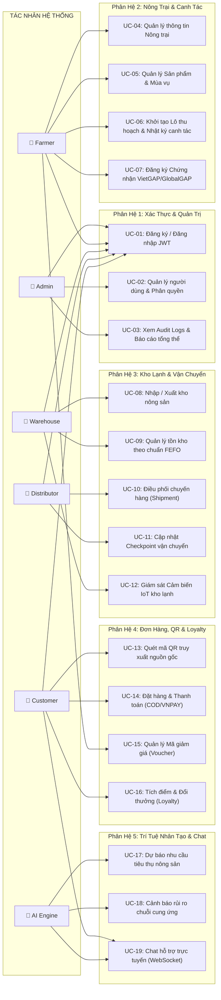

# 📑 BÁO CÁO PHÂN TÍCH & ĐẶC TẢ USE CASE HỆ THỐNG AGRITRACE AI
> **Đề tài:** Hệ Thống Quản Lý Chuỗi Cung Ứng Nông Sản Sạch Tích Hợp Trí Tuệ Nhân Tạo & Truy Xuất Nguồn Gốc QR Code  
> **Tài liệu phục vụ:** Báo cáo Đồ án Tốt nghiệp / Báo cáo Chuyên đề Phân tích Thiết kế Hệ thống  

---

## 1. TỔNG QUAN CÁC TÁC NHÂN (ACTORS) TRONG HỆ THỐNG

Hệ thống **AgriTrace AI** phục vụ toàn bộ chuỗi giá trị nông nghiệp tuần hoàn từ trang trại đến bàn ăn, bao gồm 6 tác nhân chính:

| STT | Tác nhân (Actor) | Biểu tượng | Vai trò & Trách nhiệm chính |
|:---:|---|:---:|---|
| 1 | **Quản Trị Viên (Admin)** | 👑 | Quản lý người dùng, phân quyền RBAC, kiểm duyệt chứng nhận VietGAP, cấu hình chính sách hệ thống, xem báo cáo tổng hợp chuỗi cung ứng. |
| 2 | **Chủ Trang Trại (Farmer)** | 🌾 | Quản lý thông tin nông trại, cấu hình mùa vụ, ghi nhật ký canh tác (EC, pH, phân bón), tạo lô thu hoạch, tạo mã QR truy xuất và cấu hình voucher khuyến mãi. |
| 3 | **Thủ Kho (Warehouse Staff)** | 🏢 | Tiếp nhận lô nông sản, quản lý kho lạnh, kiểm soát tồn kho theo quy tắc xuất hàng **FEFO** (Hạn dùng trước - Xuất trước), giám sát cảm biến IoT nhiệt độ/độ ẩm. |
| 4 | **Nhà Phân Phối (Distributor)** | 🚚 | Tiếp nhận chuyến hàng từ kho, điều phối phương tiện vận chuyển, cập nhật hành trình vận chuyển theo thời gian thực (Checkpoints). |
| 5 | **Khách Hàng (Customer)** | 🛒 | Xem danh mục nông sản, quét mã QR truy xuất nguồn gốc nông trại, đặt hàng online, thanh toán, tích điểm thành viên (Loyalty) và chat tư vấn. |
| 6 | **Hệ Thống AI (System / AI Engine)** | 🤖 | Tác nhân hậu đài: Thu thập dữ liệu dự báo nhu cầu thị trường, phân tích cảnh báo nguy cơ hỏng hàng/quá hạn, hỗ trợ tư vấn tự động qua Chatbot. |

---

## 2. SƠ ĐỒ USE CASE TỔNG QUÁT (USE CASE DIAGRAM)

---

## 3. DANH MỤC MA TRẬN USE CASE THEO 5 THÀNH VIÊN (30 USE CASES)

Bảng phân chia trách nhiệm chi tiết cho 5 thành viên trong nhóm làm đồ án:

### 👤 Thành Viên 1: Phân Hệ Xác Thực, Phân Quyền & Quản Trị Hệ Thống (Auth & Admin)
| Mã UC | Tên Use Case | Tác nhân chính | Mức độ ưu tiên | Mô tả tóm tắt |
|:---:|---|:---:|:---:|---|
| **UC-01** | Đăng ký tài khoản mới | Customer / Guest | High | Tạo tài khoản cá nhân, mã hóa mật khẩu BCrypt, gán quyền mặc định. |
| **UC-02** | Đăng nhập & Cấp phát JWT | Tất cả Actor | High | Xác thực danh tính qua email/password, cấp phát Access Token & Refresh Token. |
| **UC-03** | Làm mới Token (Refresh Token) | Hệ thống / Client | High | Tự động gia hạn phiên đăng nhập khi Access Token hết hạn mà không cần login lại. |
| **UC-04** | Quản lý thông tin cá nhân (Profile) | Tất cả Actor | Medium | Xem và cập nhật họ tên, số điện thoại, ảnh đại diện, đổi mật khẩu. |
| **UC-05** | Quản lý danh sách Người dùng (CRUD) | Admin | High | Xem danh sách, kích hoạt / khóa tài khoản, tạo mới người dùng nội bộ. |
| **UC-06** | Phân quyền vai trò (Role Assignment) | Admin | High | Gán hoặc thu hồi vai trò (Farmer, Warehouse, Distributor, Admin). |

---

### 👤 Thành Viên 2: Phân Hệ Nông Trại, Mùa Vụ & Quản Lý Canh Tác (Farm & Crops)
| Mã UC | Tên Use Case | Tác nhân chính | Mức độ ưu tiên | Mô tả tóm tắt |
|:---:|---|:---:|:---:|---|
| **UC-07** | Quản lý hồ sơ Nông trại | Farmer, Admin | High | Đăng ký thông tin trang trại, diện tích, tọa độ, địa chỉ, người đại diện. |
| **UC-08** | Quản lý Danh mục & Sản phẩm | Farmer, Admin | High | Thêm/sửa sản phẩm rau củ quả, đơn giá, đơn vị tính, phân loại nhóm rau. |
| **UC-09** | Cấu hình Mùa vụ canh tác | Farmer | Medium | Thiết lập kế hoạch vụ mùa (tháng gieo trồng, tháng thu hoạch, sản lượng dự kiến). |
| **UC-10** | Quản lý Chứng nhận (VietGAP/GlobalGAP) | Farmer, Admin | High | Tải lên giấy chứng nhận, số hiệu, ngày hết hạn; Admin phê duyệt tính hợp lệ. |
| **UC-11** | Khởi tạo Lô thu hoạch (Harvest Lots) | Farmer | High | Tạo mã lô thu hoạch độc bản (`LOT-XL-...`), ngày gieo, ngày thu hoạch, hạn dùng. |
| **UC-12** | Ghi Nhật ký canh tác (Farming Logs) | Farmer | High | Ghi lại lịch sử bón phân, tưới tiêu, đo chỉ số pH/EC và phun thuốc bảo vệ sinh học. |

---

### 👤 Thành Viên 3: Phân Hệ Kho Lạnh, Tồn Kho FEFO & Logistics (Warehouse & Logistics)
| Mã UC | Tên Use Case | Tác nhân chính | Mức độ ưu tiên | Mô tả tóm tắt |
|:---:|---|:---:|:---:|---|
| **UC-13** | Quản lý danh mục Kho bãi | Warehouse, Admin | High | Thiết lập thông số kho hàng (sức chứa tấn, nhiệt độ phòng lạnh tiêu chuẩn). |
| **UC-14** | Nhập kho từ Nông trại | Warehouse | High | Kiểm tra lô nông sản, số lượng thực tế, hạn dùng và lưu vào kho bảo quản. |
| **UC-15** | Xuất kho theo chuẩn FEFO | Warehouse | High | Thuật toán tự động đề xuất xuất các lô có hạn dùng gần nhất trước để tránh hao hụt. |
| **UC-16** | Giám sát Cảm biến IoT nhiệt độ kho | Warehouse, AI | High | Theo dõi nhiệt độ/độ ẩm real-time, ghi log và cảnh báo biến động nhiệt độ. |
| **UC-17** | Khởi tạo Chuyến hàng vận chuyển (Shipment)| Distributor | High | Gom các đơn hàng thành chuyến xe, gán biển số xe, tài xế và kho xuất phát. |
| **UC-18** | Cập nhật Hành trình vận chuyển (Tracking) | Distributor | High | Cập nhật trạng thái lộ trình (`Đang lấy hàng` -> `Đang vận chuyển` -> `Đã giao`). |

---

### 👤 Thành Viên 4: Phân Hệ Thương Mại, QR Truy Xuất & Khách Hàng (Commerce, QR & Loyalty)
| Mã UC | Tên Use Case | Tác nhân chính | Mức độ ưu tiên | Mô tả tóm tắt |
|:---:|---|:---:|:---:|---|
| **UC-19** | Sinh & In mã QR độc bản cho lô hàng | Farmer, System | High | Tự động tạo mã QR định danh duy nhất theo tiêu chuẩn GS1 gắn liền với Lô thu hoạch. |
| **UC-20** | Quét mã QR truy xuất nguồn gốc | Customer, Guest | High | Khách hàng quét QR xem toàn bộ thông tin nông trại, giấy phép VietGAP, lịch sử bón phân. |
| **UC-21** | Quản lý Giỏ hàng & Đặt hàng | Customer | High | Thêm sản phẩm vào giỏ, chọn địa chỉ nhận hàng, áp dụng mã voucher. |
| **UC-22** | Thanh toán đơn hàng (COD / VNPay) | Customer | High | Xử lý thanh toán tiền mặt khi nhận hoặc thanh toán cổng ngân hàng điện tử. |
| **UC-23** | Quản lý Kho Voucher & Mã giảm giá | Farmer, Admin | Medium | Cấu hình mã voucher (% giảm, giảm cố định, freeship, giá trị đơn tối thiểu). |
| **UC-24** | Tích điểm & Thăng hạng Hội viên (Loyalty) | Customer, System | Medium | Tự động cộng điểm sau mỗi đơn hàng hoàn tất; thăng hạng Bronze -> Silver -> Gold. |

---

### 👤 Thành Viên 5: Phân Hệ Trí Tuệ Nhân Tạo & Hỗ Trợ Khách Hàng (AI & WebSocket Chat)
| Mã UC | Tên Use Case | Tác nhân chính | Mức độ ưu tiên | Mô tả tóm tắt |
|:---:|---|:---:|:---:|---|
| **UC-25** | Dự báo nhu cầu tiêu thụ nông sản (AI) | AI Engine, Admin | High | Thuật toán học máy dự báo sản lượng tiêu thụ tuần/tháng dựa trên thời tiết & mùa vụ. |
| **UC-26** | Cảnh báo rủi ro chuỗi cung ứng (Risk Alert) | AI Engine, Warehouse | High | Tự động quét và cảnh báo hàng sắp hết hạn trong kho hoặc chuyến xe giao trễ hạn. |
| **UC-27** | Gợi ý sản phẩm thông minh | AI Engine, Customer | Medium | Gợi ý sản phẩm tươi ngon theo mùa vụ hoặc nông sản thu hoạch trong ngày. |
| **UC-28** | Chat tư vấn trực tuyến (WebSocket) | Customer, Farmer/Staff | High | Nhắn tin thời gian thực giữa người mua và chủ vườn để trao đổi thắc mắc nông sản. |
| **UC-29** | Trợ lý ảo AI tư vấn nông sản tự động | Customer, AI Engine | Medium | Chatbot trả lời tức thì về cách bảo quản rau, công dụng dinh dưỡng, chứng nhận sạch. |
| **UC-30** | Dashboard thống kê phân tích đa chiều | Tất cả Actor | High | Biểu đồ trực quan hóa doanh thu, tỷ lệ giao hàng đúng hạn, tỷ lệ hao hụt kho. |

---

## 4. ĐẶC TẢ CHI TIẾT CÁC USE CASE TRỌNG TÂM (USE CASE SPECIFICATIONS)

Dưới đây là mẫu đặc tả chuẩn công nghệ phần mềm cho các Use Case quan trọng nhất của từng phân hệ:

---

### 📋 ĐẶC TẢ USE CASE 1: [UC-11] Khởi Tạo Lô Thu Hoạch Nông Sản (Harvest Lot)
- **Tác nhân chính (Primary Actor):** Chủ Trang Trại (Farmer)
- **Tác nhân phụ (Secondary Actor):** Hệ thống tạo mã QR tự động
- **Mục tiêu:** Tạo mới một lô thu hoạch rau củ quả chuẩn hóa, làm gốc dữ liệu cho truy xuất nguồn gốc và xuất kho.
- **Tiền điều kiện (Pre-conditions):**
  1. Farmer đã đăng nhập thành công vào trang quản trị (`/dashboard/farmer`).
  2. Nông trại và Sản phẩm đã được khởi tạo trong hệ thống.
- **Hậu điều kiện (Post-conditions):**
  - Lô thu hoạch được lưu vào bảng `harvest_lots` với trạng thái `APPROVED`.
  - Hệ thống tự động sinh 01 mã QR độc bản tương ứng trong bảng `qr_codes`.
- **Luồng sự kiện chính (Main Success Scenario):**
  1. Farmer chọn menu "Quản lý Lô Thu Hoạch" và bấm "Thêm Lô Mới".
  2. Hệ thống hiển thị form nhập liệu: Chọn nông trại, chọn sản phẩm, chọn giấy chứng nhận VietGAP (nếu có), ngày gieo trồng, ngày thu hoạch, hạn dùng, số lượng (kg), nhiệt độ bảo quản yêu cầu.
  3. Farmer điền thông tin và bấm "Lưu & Khởi Tạo".
  4. Hệ thống kiểm tra hợp lệ:
     - Ngày thu hoạch phải sau ngày gieo hạt.
     - Hạn dùng phải sau ngày thu hoạch.
     - Số lượng sản lượng phải lớn hơn 0.
  5. Hệ thống sinh mã lô duy nhất theo định dạng: `LOT-[MÃ_SP]-[NĂM]-[SỐ_THỨ_TỰ]`.
  6. Hệ thống tạo bản ghi QR code liên kết trực tiếp với ID của lô này.
  7. Hệ thống thông báo tạo lô thành công và hiển thị nút "In Mã QR Lô Hàng".
- **Luồng ngoại lệ (Alternative / Exception Flows):**
  - *4a. Ngày tháng không hợp lệ:* Hệ thống báo đỏ trường ngày tháng: "Hạn dùng không thể trước ngày thu hoạch". Form giữ nguyên dữ liệu đã nhập.
  - *4b. Trùng mã lô:* Hệ thống tự động tái sinh hậu tố ngẫu nhiên để đảm bảo tính duy nhất.

---

### 📋 ĐẶC TẢ USE CASE 2: [UC-15] Xuất Kho Nông Sản Chuẩn FEFO (First Expired, First Out)
- **Tác nhân chính (Primary Actor):** Thủ Kho (Warehouse Staff)
- **Mục tiêu:** Xuất hàng đi giao bảo đảm ưu tiên xuất các lô có hạn dùng gần nhất trước, giảm tỷ lệ hư hỏng nông sản tươi sống về 0%.
- **Tiền điều kiện:** 
  - Thủ kho đã đăng nhập vào hệ thống kho (`/dashboard/warehouse`).
  - Có đơn hàng hoặc yêu cầu phân phối cần lấy sản phẩm $X$.
- **Hậu điều kiện:**
  - Số lượng tồn kho của lô hàng trong `warehouse_inventory` giảm đi tương ứng.
  - Bản ghi nhật ký xuất kho được tạo trong `stock_transactions`.
- **Luồng sự kiện chính:**
  1. Thủ kho chọn sản phẩm cần xuất kho và nhập số lượng cần xuất (Ví dụ: 100 kg Xà lách).
  2. Thủ kho bấm "Đề Xuất Lô Xuất Kho".
  3. Hệ thống chạy giải thuật **FEFO**:
     - Quét bảng `warehouse_inventory` lấy các lô của sản phẩm này còn hạn dùng và còn tồn kho $> 0$.
     - Sắp xếp tăng dần theo `expiry_date ASC` (Lô hết hạn sớm nhất đứng đầu).
  4. Hệ thống hiển thị danh sách phân bổ:
     - *Ví dụ:* Lô A (hạn dùng 3 ngày nữa): xuất hết 60 kg; Lô B (hạn dùng 7 ngày nữa): xuất 40 kg.
  5. Thủ kho kiểm tra thực tế tại kệ kho lạnh và bấm xác nhận "Thực Hiện Xuất Kho".
  6. Hệ thống trừ tồn kho của Lô A và Lô B, ghi lịch sử `stock_transactions` loại `EXPORT`.
  7. Hệ thống in phiếu xuất kho có đầy đủ mã QR của từng kiện hàng.
- **Luồng ngoại lệ:**
  - *3a. Tổng số lượng tồn kho không đủ:* Hệ thống thông báo cảnh báo: "Tồn kho khả dụng chỉ còn 75 kg, không đủ 100 kg yêu cầu". Cho phép xuất tối đa lượng hàng còn lại hoặc hủy yêu cầu.

---

### 📋 ĐẶC TẢ USE CASE 3: [UC-20] Quét Mã QR Truy Xuất Nguồn Gốc (Traceability)
- **Tác nhân chính (Primary Actor):** Khách Hàng (Customer) hoặc Người Tiêu Dùng Vãng Lai (Guest)
- **Mục tiêu:** Minh bạch toàn bộ nguồn gốc thực phẩm từ trang trại, quy trình bón phân, giấy kiểm định chất lượng đến thời gian thu hoạch.
- **Tiền điều kiện:** Khách hàng sử dụng camera điện thoại hoặc tính năng quét mã QR trên ứng dụng.
- **Hậu điều kiện:** Số lượt quét `scan_count` trong bảng `qr_codes` tăng thêm 1; thời gian quét cuối được ghi nhận.
- **Luồng sự kiện chính:**
  1. Khách hàng hướng camera quét mã QR in trên bao bì gói rau/trái cây (URL dạng: `https://agritrace.vn/trace/AGRI-QR-XL-2026-08-DEMO`).
  2. Hệ thống tiếp nhận mã token từ URL và tìm kiếm bản ghi trong bảng `qr_codes`.
  3. Hệ thống truy vấn liên kết:
     - Lấy thông tin nông trại từ bảng `farms` (Tên trang trại, địa chỉ, người quản lý, số điện thoại).
     - Lấy thông tin chứng chỉ từ bảng `certifications` (VietGAP số hiệu, cơ quan cấp, ngày hiệu lực, ảnh chứng chỉ gốc).
     - Lấy nhật ký canh tác từ bảng `farming_logs` (Các giai đoạn gieo hạt, tưới nước, phân bón sinh học, kiểm tra nồng độ dinh dưỡng).
     - Lấy nhiệt độ bảo quản và hạn sử dụng từ bảng `harvest_lots`.
     - Lấy lịch sử hành trình vận chuyển từ bảng `tracking_events`.
  4. Hệ thống hiển thị giao diện "Hồ Sơ Nông Sản Minh Bạch" với giao diện trực quan, timeline quy trình từ Nông trại ➔ Kho lạnh ➔ Quầy kệ.
  5. Hệ thống tăng bộ đếm lượt quét `scan_count += 1`.
- **Luồng ngoại lệ:**
  - *2a. Mã QR không tồn tại trong hệ thống:* Hiển thị màn hình cảnh báo: "Mã QR không hợp lệ hoặc nông sản không nằm trong hệ thống AgriTrace AI. Vui lòng cẩn thận hàng giả!"

---

### 📋 ĐẶC TẢ USE CASE 4: [UC-26] Cảnh Báo Nguy Cơ Rủi Ro Chuỗi Cung Ứng (AI Risk Alert)
- **Tác nhân chính (Primary Actor):** AI Engine (Hậu đài)
- **Tác nhân hưởng lợi:** Thủ Kho, Chủ Nông Trại, Quản Trị Viên
- **Mục tiêu:** Tự động phát hiện nguy cơ nông sản hư hỏng sớm, cảnh báo bất thường nhiệt độ hoặc hàng tồn kho quá lâu.
- **Tiền điều kiện:** Dữ liệu nhiệt độ kho lạnh IoT và hạn dùng lô hàng được ghi nhận liên tục.
- **Hậu điều kiện:** Bản ghi cảnh báo được lưu vào bảng `ai_risk_alerts` với mức độ nghiêm trọng (Severity: `LOW`, `MEDIUM`, `HIGH`, `CRITICAL`).
- **Luồng sự kiện chính:**
  1. Tác vụ định kỳ (Cron Schedule) của AI Engine kích hoạt mỗi 30 phút.
  2. AI Engine thực hiện các thuật toán đối soát:
     - **Đối soát hạn dùng:** Quét bảng `harvest_lots` và `warehouse_inventory`, tìm các lô hàng có số ngày còn hạn $\le 3$ ngày mà tồn kho $> 20\%$.
     - **Đối soát nhiệt độ kho lạnh:** So sánh log nhiệt độ từ cảm biến IoT (`iot_sensor_logs`) với ngưỡng an toàn quy định của loại rau quả đó (ví dụ: yêu cầu $2^\circ\text{C} - 6^\circ\text{C}$, nếu vượt quá $10^\circ\text{C}$ trong hơn 2 giờ liên tục).
  3. Nếu phát hiện vi phạm, AI phân loại mức độ rủi ro:
     - Ví dụ: Lô xà lách còn 2 ngày hạn, tồn kho 300kg ➔ Mức độ: `HIGH` (Nguy cơ hết hạn).
  4. AI sinh giải pháp đề xuất: "Khuyến nghị ưu tiên xuất kho FEFO và áp dụng Voucher kích cầu giảm giá 20% cho khách hàng thân thiết".
  5. Hệ thống gửi thông báo đẩy (Notification) tới Dashboard của Thủ kho và Nông dân phụ trách.
  6. Bản ghi được lưu lại để phục vụ phân tích báo cáo phòng ngừa rủi ro.

---

## 5. BẢNG PHÂN CÔNG TRÁCH NHIỆM & TIẾN ĐỘ THÀNH VIÊN (RACI MATRIX)

| Thành viên | Phân hệ phụ trách | Use Cases chính | Công nghệ sử dụng | Bảng Database chịu trách nhiệm |
|:---:|---|---|---|---|
| **Member 1** *(Trưởng nhóm)* | **Xác thực & Quản trị hệ thống** | UC-01 ➔ UC-06 | Spring Security, JWT, BCrypt, Next.js Auth Store | `users`, `roles`, `user_roles`, `refresh_tokens`, `projects` |
| **Member 2** | **Nông trại, Sản phẩm & Mùa vụ** | UC-07 ➔ UC-12 | Spring Data JPA, RESTful API, React Hook Form, Cloudinary | `farms`, `categories`, `products`, `crop_seasons`, `certifications`, `harvest_lots`, `farming_logs` |
| **Member 3** | **Kho lạnh FEFO & Vận chuyển** | UC-13 ➔ UC-18 | FEFO Algorithm, IoT Simulator, Geolocation Tracking | `warehouses`, `warehouse_inventory`, `stock_transactions`, `shipments`, `tracking_events` |
| **Member 4** | **Thương mại, QR Code & Khách hàng** | UC-19 ➔ UC-24 | QR Generator (ZXing), VNPay Gateway, Loyalty Engine | `qr_codes`, `orders`, `order_items`, `payments`, `vouchers`, `loyalty_memberships`, `loyalty_transactions` |
| **Member 5** | **Trí tuệ nhân tạo (AI) & WebSocket Chat** | UC-25 ➔ UC-30 | WebSocket (STOMP), OpenAI/LLM API, Recharts Dashboard | `ai_demand_forecasts`, `ai_risk_alerts`, `chat_rooms`, `chat_messages` |

---
*Tài liệu được tổng hợp chuẩn hóa theo kiến trúc hệ thống AgriTrace AI phục vụ báo cáo Đồ án tốt nghiệp.*
