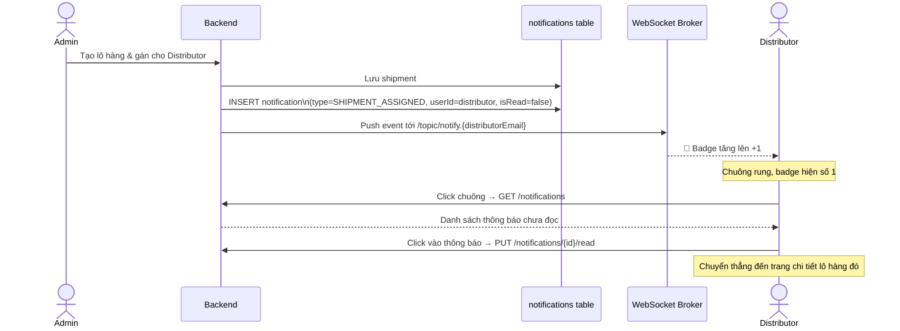
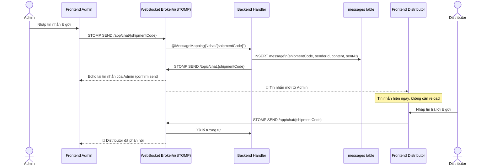
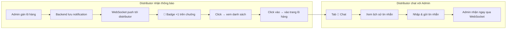

# 💬 Thiết Kế Tính Năng Real-Time Messaging — Distributor Module

---

## 🎯 Tính Năng Đề Xuất

Thêm **2 tính năng kết hợp** vào module Distributor:

| # | Tính năng | Mô tả |
|---|---|---|
| 1 | 🔔 **Notification Center** | Chuông thông báo góc trên, badge đếm unread, danh sách thông báo |
| 2 | 💬 **Chat theo lô hàng** | Mỗi lô hàng có 1 thread chat riêng giữa Admin ↔ Distributor |

> [!NOTE]
> Dùng **WebSocket (STOMP)** cho chat 2 chiều thật sự. SSE hiện có vẫn giữ nguyên cho real-time reload data.

---

## 1. Notification Center — Luồng Nghiệp Vụ

### Người dùng thấy gì?

```
[Thanh điều hướng trái]                    [Góc phải trên]
 Tổng Quan                                  🔔 (3)  ← badge đỏ số unread
 Quản Lý Đơn Hàng
 Quản Lý Vận Chuyển                        Khi click chuông:
 ...                                        ┌─────────────────────────┐
                                            │ 🔴 Lô hàng mới được gán │
                                            │    SHIP-0023 · 2 phút   │
                                            │─────────────────────────│
                                            │ 🟡 Admin nhắn tin       │
                                            │    "Giao gấp trước 5h"  │
                                            │─────────────────────────│
                                            │ ✅ SHIP-0021 đã nhận    │
                                            │    Cập nhật thành công  │
                                            └─────────────────────────┘
```

### Luồng khi Admin gán lô hàng mới



---

## 2. Chat theo Lô Hàng — Luồng Nghiệp Vụ

### Người dùng thấy gì?

```
[Trang Chi Tiết Lô Hàng SHIP-0023]
┌──────────────────────────────────────────────────────┐
│  SHIP-0023 · Đang vận chuyển                   [...]  │
│  Hà Nội → Đà Nẵng · Deadline: 17:00 hôm nay         │
├──────────────────────────────────────────────────────┤
│  📦 Thông tin lô hàng  │  🗺️ Tracking  │  💬 Chat (2) │
├──────────────────────────────────────────────────────┤
│                     💬 Trao đổi                       │
│                                                      │
│  [Admin] 14:32                                       │
│  Lô này cần giao trước 17h, khách VIP               │
│                                                      │
│                              [Bạn] 14:35             │
│                     Đã hiểu, đang trên đường ạ       │
│                                                      │
│  [Admin] 14:36                                       │
│  Cảm ơn, cập nhật cho tôi khi đến nơi nhé           │
│                                                      │
│ ┌────────────────────────────────────┐  [Gửi ➤]    │
│ │ Nhập tin nhắn...                   │              │
│ └────────────────────────────────────┘              │
└──────────────────────────────────────────────────────┘
```

### Luồng gửi/nhận tin nhắn



---

## 3. Kiến Trúc Tổng Thể

```mermaid
flowchart TD
    subgraph Frontend
        A[🔔 Notification Bell] 
        B[💬 Chat Box trong\ntrang chi tiết lô hàng]
        C[realtime.ts\nSSE hiện có]
    end

    subgraph Backend
        D[WebSocket Config\nSTOMP Broker]
        E[NotificationController\n@MessageMapping]
        F[ChatController\n@MessageMapping]
        G[Service Layer]
        H[SSE hiện có\nSseEmitter]
    end

    subgraph Database
        I[(notifications)]
        J[(messages)]
        K[(shipments\nhiện có)]
    end

    A <-->|WebSocket| D
    B <-->|WebSocket| D
    C <-->|SSE| H
    D --> E
    D --> F
    E --> G --> I
    F --> G --> J
    G --> K
```

---

## 4. Các Loại Thông Báo (Notification Types)

| Type | Icon | Khi nào trigger | Ai nhận |
|---|---|---|---|
| `SHIPMENT_ASSIGNED` | 📦 | Admin tạo & gán lô hàng | Distributor |
| `SHIPMENT_CANCELLED` | ❌ | Admin hủy lô hàng | Distributor |
| `SHIPMENT_OVERDUE` | ⏰ | Quá deadline chưa giao | Distributor + Admin |
| `NEW_MESSAGE` | 💬 | Có tin nhắn mới trong lô hàng | Distributor hoặc Admin |
| `STATUS_UPDATED` | 🔄 | Distributor cập nhật trạng thái | Admin |
| `QR_RECEIVED` | ✅ | Distributor quét QR xác nhận nhận | Admin |

---

## 5. Dữ Liệu Cần Lưu

### Bảng `notifications`

| Cột | Loại | Mô tả |
|---|---|---|
| id | UUID | Khóa chính |
| user_id | UUID | Người nhận thông báo |
| type | String | Loại thông báo (xem trên) |
| title | String | "Lô hàng mới được gán" |
| content | String | Nội dung chi tiết |
| reference_code | String | Mã lô hàng liên quan |
| is_read | Boolean | Đã đọc chưa |
| created_at | Timestamp | Thời gian tạo |

### Bảng `messages`

| Cột | Loại | Mô tả |
|---|---|---|
| id | UUID | Khóa chính |
| shipment_code | String | Lô hàng thuộc về |
| sender_id | UUID | Người gửi |
| sender_role | String | ADMIN / DISTRIBUTOR |
| content | String | Nội dung tin nhắn |
| sent_at | Timestamp | Thời gian gửi |
| is_read | Boolean | Người kia đã đọc chưa |

---

## 6. Luồng Kết Hợp Hoàn Chỉnh



---

## 7. Tóm Tắt Việc Cần Làm (Khi Quyết Định Code)

> [!IMPORTANT]
> Đây chỉ là danh sách việc cần làm — **chưa code gì cả**.

### Backend cần thêm:
1. Dependency: `spring-boot-starter-websocket` vào `pom.xml`
2. Config: `WebSocketConfig` — cấu hình STOMP endpoint & broker
3. Entity: `Notification` + `Message`
4. Repository: `NotificationRepository` + `MessageRepository`
5. Controller: `NotificationController` (REST) + `ChatController` (WebSocket)
6. Service: `NotificationService` + `ChatService`
7. Tích hợp: Các service hiện có (ShipmentService...) gọi thêm `NotificationService.send()`

### Frontend cần thêm:
1. Thư viện: `@stomp/stompjs` hoặc `sockjs-client`
2. Component: `NotificationBell` (chuông + badge + dropdown)
3. Component: `ChatBox` (trong trang chi tiết lô hàng)
4. Service: `websocket.service.ts` — kết nối & subscribe STOMP
5. Trang: `/notifications` — xem tất cả thông báo

---

> [!TIP]
> **Thứ tự nên làm:** Backend trước (WebSocket config + Notification entity + Chat entity) → Test bằng Postman/wscat → Rồi mới làm Frontend.
