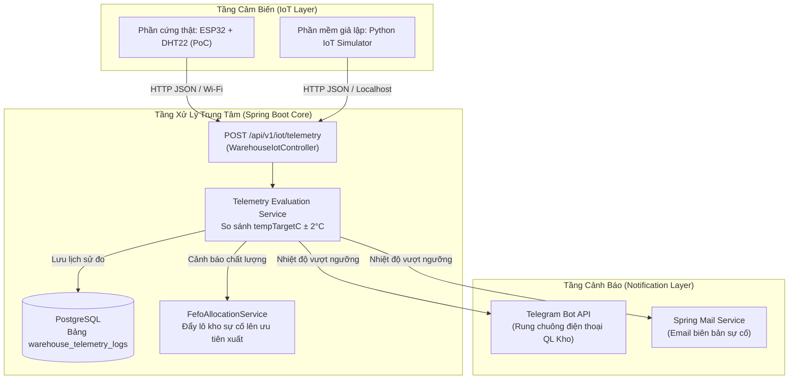

# KẾ HOẠCH TRIỂN KHAI TÍNH NĂNG IOT GIÁM SÁT KHO LẠNH REALTIME & CẢNH BÁO SỰ CỐ
**Dự án:** AgriTrace-AI — Module Warehouse  
**Người thực hiện:** Phạm Bá Trí  
**Mục tiêu:** Giám sát nhiệt độ/độ ẩm kho lạnh theo thời gian thực, tự động phát hiện sự cố, gửi cảnh báo tức thì qua Telegram/Email và liên kết với thuật toán xuất kho FEFO.

---

## 1. TỔNG QUAN KIẾN TRÚC & LUỒNG DỮ LIỆU

---

## 2. LỘ TRÌNH TRIỂN KHAI CHI TIẾT (6 BƯỚC)

### Giai đoạn 1: Cơ sở dữ liệu & Cấu hình (Database & Config)
- [ ] **Bảng `warehouse_telemetry_logs`**:
  - `id` (UUID, PK)
  - `warehouse_id` (UUID, FK -> warehouses)
  - `location_id` (UUID, FK -> storage_locations, nullable)
  - `temperature` (DECIMAL(4,1))
  - `humidity` (DECIMAL(4,1))
  - `is_alert` (BOOLEAN: true nếu vượt ngưỡng)
  - `recorded_at` (TIMESTAMP)
- [ ] **Bổ sung Config trong `application.yml`**:
  - Ngưỡng dung sai: `warehouse.iot.temp-tolerance: 2.0`
  - Cấu hình Telegram: `telegram.bot.token`, `telegram.bot.chat-id`
  - Cấu hình Email cảnh báo.

### Giai đoạn 2: Phát triển Backend API & Nghiệp vụ cốt lõi
- [ ] **DTO & Controller**:
  - Tạo `TelemetryPayload(warehouseId, locationId, temperature, humidity, timestamp)`.
  - Endpoint `POST /api/v1/iot/telemetry` (cho phép IoT Gateway / ESP32 đẩy dữ liệu về).
- [ ] **Evaluation Service (`WarehouseTelemetryService`)**:
  - Đọc `tempTargetC` và `humidityTarget` từ entity `Warehouse`.
  - Tính độ lệch: `|temperature - tempTargetC|`.
  - Nếu `độ lệch > 2.0°C` -> Kích hoạt chuông báo động.
  - Rate limiting cảnh báo: Tránh spam tin nhắn (chỉ gửi lại cảnh báo sau mỗi 5 - 10 phút nếu sự cố chưa khắc phục).

### Giai đoạn 3: Tích hợp Kênh Cảnh Báo Realtime
- [ ] **Telegram Alert Service**:
  - Khởi tạo Bot qua Telegram `@BotFather` (lấy Token & Chat ID).
  - Sử dụng Spring `RestClient` bắn tin nhắn khẩn cấp kèm icon chuông báo 🚨.
- [ ] **Email Alert (Tùy chọn)**:
  - Tận dụng `spring-boot-starter-mail` đã có sẵn trong `pom.xml`.
  - Gửi email tóm tắt sự cố đến Quản lý kho (`warehouse.manager.email`).

### Giai đoạn 4: Bộ công cụ Giả lập & Thiết bị thực tế (Dual-Mode Demo)
- [ ] **Chế độ 1 - Python Simulator (`iot_sensor_simulator.py`)**:
  - Chạy trên máy tính, gửi dữ liệu định kỳ mỗi 5 giây.
  - Hỗ trợ phím tắt chuyển đổi trạng thái: `0` (Bình thường: 4.0°C) và `1` (Sự cố: tăng vọt lên 8.5°C).
- [ ] **Chế độ 2 - Mạch phần cứng thật (ESP32 + DHT22)**:
  - Nạp code C++ qua Arduino IDE.
  - Mạch đọc nhiệt độ môi trường thật, phát Wi-Fi và bắn POST JSON về máy chủ.

### Giai đoạn 5: Nâng cấp FEFO Thông minh (Dynamic FEFO Integration)
- [ ] Thêm cờ `compromised` vào lô hàng hoặc kho đang gặp sự cố nhiệt độ kéo dài.
- [ ] Cập nhật [FefoAllocationService.java](file:///d:/Springboot%20Project/AgriTrace-AI/backend/src/main/java/com/example/myfullstackapp/service/FefoAllocationService.java):
  - Ưu tiên xuất các lô hàng nằm trong kho đang bị biến động nhiệt độ trước để "giải cứu hàng", tránh hư hỏng gây tổn thất.

### Giai đoạn 6: Viết Test & Chuẩn bị Kịch bản Báo cáo (Defense Prep)
- [ ] Viết bài Unit Test / Integration Test cho `WarehouseTelemetryService`.
- [ ] Soạn kịch bản nói 2 phút biểu diễn kịch tính:
  1. Chiếu màn hình Dashboard kho nhiệt độ xanh (bình thường).
  2. Bật sự cố trên Simulator / Hà hơi vào mạch ESP32.
  3. Màn hình điện thoại rung chuông nổ thông báo Telegram ngay trước mặt thầy cô.
  4. Giải thích câu hỏi lý thuyết: Sự khác biệt giữa PoC (ESP32) và thiết bị công nghiệp ngoài doanh nghiệp.

---

## 3. CHECKLIST CÔNG VIỆC THEO NGÀY (Dự kiến 3 - 4 ngày hoàn thành)

| Ngày | Hạng mục công việc | Output hoàn thành |
| :--- | :--- | :--- |
| **Ngày 1** | Tạo bảng DB + DTO + Controller nhận Telemetry | API `/api/v1/iot/telemetry` nhận được JSON và lưu DB |
| **Ngày 2** | Service so sánh ngưỡng + Tích hợp Telegram Bot | Bắn được tin nhắn Telegram khi nhiệt độ > 6°C |
| **Ngày 3** | Viết script Python Simulator + Test luồng hoàn chỉnh | Chạy thử nghiệm giả lập sự cố mượt mà |
| **Ngày 4** | Ghép nối FEFO + Nạp code ESP32 (nếu có mạch) + Slide | Sẵn sàng kịch bản demo cho buổi bảo vệ |

---

## 4. GHI CHÚ KỸ THUẬT & AN TOÀN KHI BÁO CÁO

> [!IMPORTANT]
> **Quy tắc an toàn khi thuyết trình:**
> - Luôn chuẩn bị sẵn script Python Simulator chạy offline trên `localhost` làm phương án dự phòng chính (backup an toàn 100%).
> - Mạch ESP32 dùng làm điểm nhấn thực tế trên bàn để gây ấn tượng thị giác cho hội đồng.
